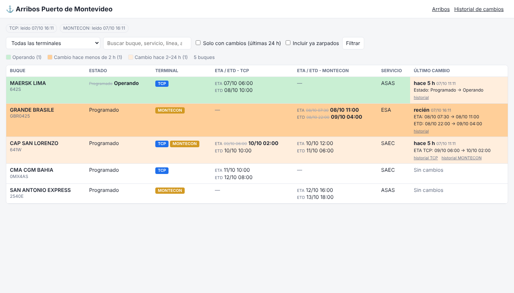

# Arribos Puerto de Montevideo

Sitio en PHP + MySQL que junta en una sola página las llegadas de buques que
publican las dos terminales (TCP y Montecon) y **destaca los cambios en la
operativa prevista** (ETA, ETD, estado y servicio).



## Qué hace

- Un proceso (`cron/actualizar.php`) lee cada 2 horas las páginas de las dos terminales.
- Compara con lo guardado y registra cada cambio (valor anterior → valor nuevo).
- La página principal muestra **una fila por buque**. Si el buque figura en las dos
  terminales, sus datos aparecen juntos. Columnas:
  **Buque · Estado · Terminal · ETA/ETD - TCP · ETA/ETD - MONTECON · Servicio · Último cambio**.
- Colores de las filas:
  - **Verde**: el buque está operando, según el texto del estado (lista configurable en `estados_operando`).
  - **Naranja**: tuvo un cambio hace menos de 2 horas.
  - **Naranja claro**: tuvo un cambio hace entre 2 y 24 horas.
  - **Sin color**: pasaron más de 24 horas sin cambios.

  Si un buque está operando y además cambió, la fila queda en verde y la celda
  "Último cambio" toma el tono naranja que corresponde.
- Mientras dura el resaltado, el dato que cambió se muestra en negrita, con el valor anterior tachado.
- Filtros por terminal, búsqueda, "solo con cambios" e "incluir ya zarpados". Arriba se ve
  la última lectura de cada terminal, en rojo si falló.
- Filtro **Servicios**: un desplegable con todos los servicios para ocultar los que no interesan.
  De entrada se ocultan CRUCERO y CIENTIFICO (lista `servicios_ocultos` en `config.php`).
  Lo que elija cada usuario queda guardado en su navegador. Si un buque está en las dos
  terminales con servicios distintos, solo se oculta cuando se ocultan los dos.
- `contenedores.php` y `clientes.php`: seguimiento de contenedores propios (ver abajo).
- `historial.php`: todos los cambios de los últimos días, o el historial completo de un buque.

Los cambios se detectan en cada lectura, así que la hora del cambio es la de la
lectura en que se vio. Con lecturas cada 2 horas, el cambio real pudo haber
ocurrido hasta 2 horas antes.

## Clientes y contenedores (Lucía)

- **Clientes** (`clientes.php`): RUT (12 dígitos) y nombre. Se cargan de a uno o pegando desde Excel.
- **Contenedores** (`contenedores.php`): número, carpeta y cliente. El número se puede escribir
  con o sin guiones o espacios. Se muestra y se envía a Lucía siempre como `AAAA-123456-7`
  (sin guiones Lucía no devuelve nada). También
  se pueden pegar desde Excel (Contenedor · Carpeta · RUT). Se valida el formato y se avisa si el
  dígito verificador del contenedor (ISO 6346) o del RUT no coincide.
- `cron/contenedores.php` consulta cada contenedor activo en el webservice de Lucía. Si Lucía
  informa el buque, el contenedor se **vincula con la escala** de ese buque en el tablero:
  1. la escala con el mismo número de viaje;
  2. si no hay coincidencia de viaje, la de ETA más cercana a la fecha que informa Lucía;
  3. si Lucía no da fecha, la más próxima a hoy que no haya zarpado.
- En el tablero, cada buque muestra sus contenedores (📦) con carpeta y cliente. Hay un filtro
  "Solo con contenedores míos". Un buque con contenedores propios nunca se oculta por servicio.
- Cuando un contenedor ya no interesa se **archiva**: deja de consultarse y de mostrarse.

### Webservice de Lucía
Se usa `awsdatcont.aspx`, método **DATOSCONTFECHAS**, con un rango de fechas amplio:
por defecto, de 60 días atrás a 30 días adelante (`dias_atras` y `dias_adelante` en `config.php`).
Devuelve DUAs, líneas de manifiesto, movimientos de stock, mensajes simplificados, movimientos
de viaje y convalidadas del contenedor en ese período. El método `DATOSCONT` también está
disponible, pero solo mira el día actual.

Confirmado con el servicio real:
- Autenticación HTTP básica con usuario y clave.
- El contenedor va en formato `AAAA-123456-7` (Lucía lo devuelve así).
- Estructura de la respuesta (WSDL): `Datoscont` con `DUAS/Dua`, `LINMANIF/Linea`, `MOVIMSTOCK/Movimiento`,
  `MS/Ms`, `INCAUTACIONES/Incaut`, `MOVIMVIAJE/Movimviaje` y `CONVALIDADA/Convalidada`.
- **Lucía no informa el nombre del buque.** El `VIAJE` de DUAS y MOVIMVIAJE es el del tránsito
  terrestre (camión), no el del barco.

Por eso el buque se busca así, en este orden:
1. **Por el manifiesto.** La sección `LINMANIF` trae la clave del manifiesto (TipoTransporte, TipoMic,
   NroMic, Deposito, FechaArribo). Con esa clave se consulta el servicio de manifiestos
   (`afMicXmlunif.aspx?1,0,291201,1650,20260101`, documentado en la
   [wiki de la Aduana](https://apliwiki.aduanas.gub.uy/WikiNovedades/wiki.aspx?8217,WEBSERVICES,)) y se toma
   el nombre del buque (`CGNomNave`) y la fecha de llegada (`CGFchLleg`). Con ese nombre se vincula
   la escala del tablero, aunque el contenedor todavía no haya llegado. Confirmado con una respuesta
   real: el manifiesto 277301 trae CAP SAN ARTEMISSIO, llegada 12/10, agencia MAERSK URUGUAY.
   La respuesta trae el manifiesto entero (puede pesar varios MB, con todos los conocimientos y
   contenedores). Se guarda en la tabla `manifiestos` solo la cabecera y, por contenedor, su
   conocimiento, así varios contenedores del mismo manifiesto generan una sola consulta.
2. **Por terminal y fecha de descarga.** Si lo anterior no da resultado: la terminal sale del operador de la convalidada
   ("TERMINAL CUENCA DEL PLATA" → TCP) o del depósito (1650 → TCP; falta el de Montecon), y la fecha,
   de la descarga. Se elige el buque que operaba en esa terminal en ese momento (entre ETB y ETD).

En la página se aclara de dónde salió el buque ("según manifiesto 291201" o "deducido por terminal y fecha").
Además, cada contenedor muestra un resumen: buque, llegada, agencia y conocimiento según el manifiesto; descarga, origen y destino, manifiesto y liberación, DUA,
mensajes simplificados, tránsito e incautaciones.

**Tracking de las navieras (FindTEU):** cuando Lucía todavía no conoce el contenedor (por ejemplo, mientras navega), o lo
conoce pero no se pudo saber el buque, se consulta FindTEU (https://www.findteu.com), que unifica el tracking de todas las
navieras. Se toma el buque con el que llega a Montevideo (UYMVD) y se vincula a la escala del tablero igual que el de Lucía.
Cada contenedor se consulta **como mucho una vez por semana** (`reconsultar_dias`; mientras tanto se usa el último
resultado) y **no se consulta más cuando ya está manifestado en Lucía**.
Se configura en `config.php → navieras` (activa y clave en `X-Authorization-ApiKey`; la de demostración es `123456789`)
y se prueba con `php cron/naviera_diagnostico.php CONTENEDOR`, que guarda la respuesta en `data/`.
También acepta APIs oficiales de navieras con el estándar DCSA Track & Trace (ver el ejemplo en `config.example.php`).

**Contenedores de cada usuario:** cada contenedor guarda quién lo cargó. En el tablero y en la página Contenedores se elige
"Contenedores: Míos / De todos" (se recuerda para la próxima vez). Los clientes son compartidos por todos.
Los contenedores cargados antes de esta opción no tienen usuario: la página Contenedores ofrece pasarlos a tu nombre.
La columna nueva se agrega sola a la base existente la primera vez que se abre el sitio.

**Entero o apertura:** al cargar un contenedor se marca si es **Entero** o **Apertura** (por defecto, Entero). Al importar
desde Excel va como cuarta columna, opcional (Entero/E/FCL o Apertura/A/LCL). Se muestra como etiqueta en el tablero y en
Contenedores, donde se puede filtrar y cambiar con "Pasar a apertura" / "Pasar a entero".

**Stock:** con los movimientos de stock de Lucía (`MOVIMSTOCK`), cada contenedor muestra una etiqueta, tanto en el
tablero (debajo del buque) como en la página Contenedores:
- **En stock** (verde): tiene una entrada en un depósito sin salida posterior. Se indica el depósito y desde cuándo.
- **Salió del stock** (gris): salió de todos los depósitos en los que entró.
- **Sin stock todavía** (amarillo): Lucía no informa ninguna entrada.

Cuando un contenedor ya ingresó a stock (aunque después haya salido), **no se consulta más en Lucía**: queda como
"Ingresó a stock (no se consulta más)". Si hiciera falta, se puede consultar a mano con el botón de la página Contenedores.

El nombre del depósito sale de `lucia → depositos` en `config.php` (por ejemplo `'1650' => 'TCP'`). Ahí se pueden agregar otros.

Dirección: `https://servicios.aduanas.gub.uy/luciaws/awsdatcont.aspx?wsdl`. Si la Aduana
habilita el acceso solo desde ciertas direcciones IP, la del servidor del sitio tiene que estar habilitada.

**Prueba rápida sin PHP (Windows 10 u 11):** copiar `herramientas/lucia_prueba.bat` y
`herramientas/lucia_prueba.ps1` en la misma carpeta y hacer doble clic en el `.bat`. Pide el
contenedor, el rango de días, el usuario y la clave (una sola vez, sin mostrarla) y guarda en esa
carpeta `wsdl.xml` y las respuestas, y al final consulta el manifiesto del contenedor
(`respuesta_manifiesto.xml`).

**Primera prueba con el sitio instalado:**
1. En `config.php` → `lucia`: `'modo' => 'soap'`, `usuario` y `clave`. **Solo en el servidor**, nunca en el repositorio.
2. Con un contenedor que venga en un barco próximo:
   ```bash
   php cron/lucia_diagnostico.php MSKU1234567        # DATOSCONTFECHAS
   php cron/lucia_diagnostico.php MSKU1234567 TOD    # DATOSCONT con Quedatos = TOD
   php cron/lucia_diagnostico.php --manifiesto 1,0,291201,1650,20260101   # solo un manifiesto
   ```
   Muestra el pedido, la respuesta completa y qué buque, viaje y fecha entendió el sistema.
3. Si no encuentra el buque, agregá en `config.php` → `lucia` → `campos` los nombres de los
   elementos de la respuesta. Por ejemplo, `'buque' => ['NomBuque']`.

Posibles errores en la primera prueba:
- **"Lucía rechazó el usuario o la contraseña (HTTP 401)":** revisar usuario y clave
  (la autenticación HTTP básica ya se confirmó con el servicio real).
- **Error de certificado:** si Lucía usa un certificado de una autoridad interna, poné la ruta
  del `.pem` en `ca_bundle`.

La respuesta puede traer datos de clientes: tachalos antes de compartirla.

## Acceso

Como el sitio guarda datos de clientes, todas las páginas piden usuario y contraseña.

- **Primer usuario:** la primera vez que se entra al sitio, si todavía no hay usuarios, la pantalla de
  ingreso pide crear uno. Por seguridad, solo desde la misma PC donde está instalado (`http://localhost/...`).
- **Más usuarios:** desde la página **Usuarios** (agregar, cambiar contraseña, borrar).
- Desde la consola también se puede: `php cron/crear_usuario.php nombre`.
- Los usuarios se guardan en la tabla `usuarios`. Los que estén definidos en `config.php` (`'usuarios'`) también valen.

## Si el servidor web apunta a la carpeta del proyecto

Lo ideal es que el servidor web apunte a `public/`. Si en XAMPP se copió la carpeta entera en `htdocs`,
`http://localhost/Puerto/` lleva solo a `public/`. El `.htaccess` de la raíz y los de cada carpeta interna
impiden ver `config.php`, el código y los datos desde el navegador.

## Instalación

1. Requisitos: PHP 8.1 o superior con las extensiones `pdo_mysql`, `openssl`, `dom`, `simplexml` y `mbstring`, y MySQL 5.7+ o MariaDB 10.3+.
   La extensión `curl` es **opcional**: si no está, el sitio se conecta con las funciones de PHP.
   En Windows, si PHP no tiene configurada la lista de certificados para HTTPS, el sitio usa la que trae XAMPP
   (`php\extras\ssl\cacert.pem`); si no la encuentra, se indica la ruta en `ca_bundle` (`http` y `lucia` en `config.php`).
   En Windows sirve XAMPP con PHP 8.2 o AppServ 9.x. **Las versiones viejas de AppServ (2.x) no sirven:** traen PHP 5.
2. Crear la base de datos y cargar el esquema:
   ```sql
   CREATE DATABASE puerto CHARACTER SET utf8mb4 COLLATE utf8mb4_unicode_ci;
   CREATE USER 'puerto'@'localhost' IDENTIFIED BY 'una-clave';
   GRANT ALL ON puerto.* TO 'puerto'@'localhost';
   ```
   ```bash
   mysql -u puerto -p puerto < sql/schema.mysql.sql
   ```
   Si el sitio ya estaba instalado, se vuelve a ejecutar el mismo comando: crea solo las tablas nuevas
   (clientes y contenedores) y no toca las existentes.
3. `cp config.example.php config.php` y completar los datos de la base.
4. Apuntar el servidor web a la carpeta `public/`. Solo esa carpeta debe quedar
   accesible desde internet.
5. Entrar al sitio desde la misma PC y crear el primer usuario (ver "Acceso").
6. Programar la lectura con cron, cada 2 horas: primero las terminales y después Lucía.
   ```
   0 */2 * * * php /ruta/a/Puerto/cron/actualizar.php >> /ruta/a/Puerto/data/cron.log 2>&1; php /ruta/a/Puerto/cron/contenedores.php >> /ruta/a/Puerto/data/cron.log 2>&1
   ```
   Para probar a mano: `php cron/actualizar.php` (o `php cron/actualizar.php TCP` para una sola terminal).
   Si cambiás en `config.php` qué columna corresponde a cada fecha, corré una vez
   `php cron/actualizar.php MONTECON --sin-cambios`: corrige las fechas sin anotarlas como cambios ni resaltar las filas.

   **En Windows (AppServ, XAMPP):** doble clic en `herramientas\programar_tareas.bat` (si da error, clic derecho →
   Ejecutar como administrador). Crea una tarea del Programador de tareas que cada 2 horas ejecuta
   `herramientas\tareas.bat`: lee las terminales, consulta Lucía y anota el resultado en `data\cron.log`.

## Instalar en un hosting (dominio propio)

En un servidor de internet no se puede entrar por `localhost`, así que verificar.php y la creación del primer usuario
se habilitan con una **clave de instalación**:
1. En `config.php`, poné una clave de al menos 12 caracteres en `'clave_instalacion'`.
2. Abrí `https://tu-dominio/verificar.php?clave=ESA-CLAVE` y corregí lo que marque en rojo.
3. Entrá al sitio: al crear el primer usuario se pide esa misma clave.
4. Cuando todo funcione, volvé a dejar `'clave_instalacion' => ''`.

La lectura cada 2 horas se programa en el panel del hosting (en cPanel: "Cron Jobs"), con la frecuencia
"cada 2 horas" (`0 */2 * * *`) y el comando que muestra **verificar.php** en "Lectura automática"
(algo como `/opt/cpanel/ea-php83/root/usr/bin/php /home/USUARIO/public_html/cron/tareas.php`).
`cron/tareas.php` lee las terminales, consulta Lucía y anota todo en `data/cron.log`; si el `php` del cron es una
versión vieja, lo anota también, con la ruta a usar. verificar.php muestra las últimas líneas de ese log.
Si la Aduana habilita Lucía solo para ciertas IP, hay que pedir que habiliten la IP del hosting.

## Si algo falla

Abrí **`http://localhost/.../verificar.php`** desde la misma PC donde está instalado el sitio. Revisa:
- versión de PHP (hace falta 8.1 o más nuevo);
- extensiones (`pdo_mysql`, `mbstring`, `dom`, `simplexml`, `openssl`; `curl` es opcional);
- que exista `config.php`;
- conexión a la base y tablas;
- usuarios.

Lo que falte aparece en rojo, con la indicación de cómo corregirlo.

Además, si ocurre un error en cualquier página, en lugar de un "HTTP ERROR 500" en blanco se muestra
qué pasó. El detalle técnico se ve solo desde la misma PC (o con `'mostrar_errores' => true` en `config.php`)
y siempre queda en el log de errores de PHP (en XAMPP: `xampp\apache\logs\error.log`).

Errores frecuentes:
- **PHP viejo:** instalar XAMPP con PHP 8.2 o más nuevo.
- **Extensión desactivada:** en `php.ini` quitar el `;` de la línea `extension=...` y reiniciar Apache.
- **Error de base de datos:** revisar `db` en `config.php`, que MySQL esté iniciado en el panel de XAMPP y
  que se haya importado `sql/schema.mysql.sql` (phpMyAdmin → base `puerto` → Importar).
- **`config.php` en otro lugar:** va en la carpeta principal del sitio (junto a `config.example.php`), no en `public`.

## De dónde salen los datos

### TCP
Se usa la misma consulta que hace la página pública https://mitcp.katoennatie.com.uy/
(Line-up): `https://api.katoennatie.com.uy/public/tcp/mitcp/frontend/v1/api/line-up`,
con la `api-key` que esa página envía desde cualquier navegador. Devuelve JSON con
`vessel`, `week`, `service`, `eta`, `etb`, `ets`, `notes`, entre otros datos.

- TCP **no publica estado**. Se calcula a partir de las fechas (ver "Estados" más abajo).
- TCP **no publica número de viaje**. Cada escala se identifica por buque + semana (`Sem. 41`).
- La columna ETD de TCP muestra la **ETS** que publica la terminal.

Si la `api-key` cambiara algún día, la lectura de TCP quedaría en rojo. La nueva clave se
obtiene igual que antes: F12 → Network → consulta `line-up` → encabezado `api-key`. Se copia en `config.php`.

### Montecon
Se usa la misma consulta que hace la página pública https://online2.montecon.com.uy/:
`POST https://api-online2.montecon.com.uy/api/query/schedule` con cuerpo `{}`.

| Montecon            | En el tablero |
|---------------------|---------------|
| `buque`, `nroViaje` | Buque y viaje |
| `servicio`          | Servicio      |
| `llegada`           | ETA (la llegada que muestra la página de Montecon; `llegadaRada` es la llegada a rada, antes) |
| `comienzoOperaciones` | ETB (inicio de operaciones) |
| `salida`            | ETD           |

- Montecon tampoco **publica estado**. Se calcula a partir de las fechas (ver "Estados" más abajo).
- Las fechas `0001-01-01` se toman como "sin dato".
- Los viajes que terminan en `/CANCEL` se muestran como "Cancelado".
- Los marcados `noMostrarSchedule` no se muestran, igual que en la página de Montecon.

### Estados
Ninguna de las dos terminales publica el estado, así que se calcula con las fechas:

| Estado | Cuándo |
|--------|--------|
| **Esperado** | Antes de la ETB (inicio de operaciones) |
| **Operando** | Entre la ETB y la ETD (fila verde) |
| **Zarpado** | Después de la ETD |
| **Cancelado** | El viaje termina en `/CANCEL` (Montecon) |

### Buques en las dos terminales
Si un buque figura en TCP y en Montecon con fechas a menos de 7 días, aparece en una sola
fila con las fechas de cada terminal (por ejemplo, las barcazas fluviales).

### Probar una terminal
```bash
php cron/diagnostico.php TCP
```
Muestra qué propiedades trae la respuesta, cuál se usa para cada campo y los primeros
buques leídos, sin guardar nada en la base.

### Agregar o ajustar una terminal
Cada terminal se configura en `config.php`, en `terminales`:
- `parser => 'json_api'`: para consultas que devuelven JSON. Busca sola la lista de buques
  y asigna cada propiedad según `columnas`.
- `parser => 'tabla_html'`: para páginas con una tabla HTML. Busca la tabla cuyos
  encabezados coinciden con `columnas`.

En los dos casos los nombres no distinguen mayúsculas ni tildes. Otras opciones de cada terminal:
- `encabezados`: encabezados HTTP que se envían con la consulta.
- `formato`: cómo se muestra un campo, por ejemplo `'Sem. %s'`.
- `estado_por_fechas`: calcula el estado a partir de ETB y ETD.
- `cuerpo_post`: envía la consulta por POST con ese cuerpo.
- `excluir_si`: descarta los elementos que tengan esa propiedad con ese valor.

Para no vaciar la lista por un error, una lectura que no devuelve buques no
modifica los datos guardados.

## Pruebas

```bash
php tests/prueba.php
```
Usa respuestas de ejemplo (`tests/fixtures/`, con respuestas reales de TCP y Montecon) y SQLite en memoria. No necesita internet ni MySQL.

Para probar el sitio completo sin MySQL, en `config.php` se puede poner `'driver' => 'sqlite'`.
